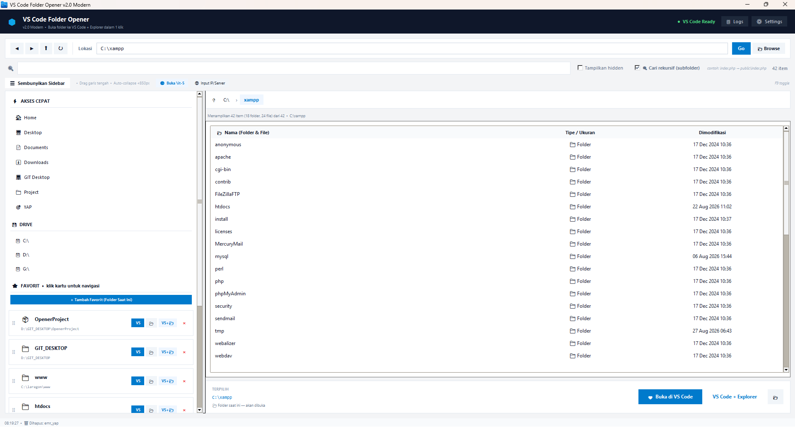
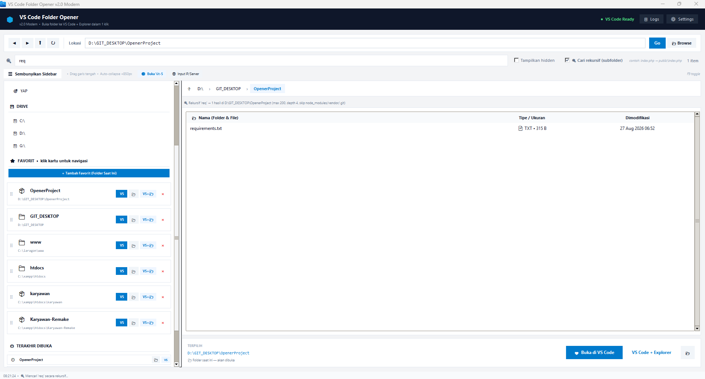

<p align="center">
  
</p>

<h1 align="center">VS Code Folder Opener <br><sup>v2.0 Modern • Windows Desktop</sup></h1>

<p align="center">
  
  
  
  
  
  
</p>

<p align="center"><b>Buka folder ke VS Code + Explorer dalam 1 klik.</b> Browser folder modern, Favorit drag & drop, Search rekursif, dan support sharing jaringan <code>\\it-5</code> / <code>\\IP</code>.</p>

<p align="center">
  <a href="#-screenshot">Screenshot</a> •
  <a href="#-fitur-utama">Fitur</a> •
  <a href="#-cara-pakai">Cara Pakai</a> •
  <a href="#-instalasi">Instalasi</a> •
  <a href="#-build-installer">Build Installer</a>
</p>

---

## 📸 Screenshot

<table>
<tr>
<td width="50%">

**Main Window** — `C:\xampp` dengan sidebar & konten folder+file



</td>
<td width="50%">

**Search Rekursif** — `req` → `requirements.txt` di subfolder



</td>
</tr>
</table>

> Logo: `logo.png` (1290 KB PNG) + `logo.ico` (7 ukuran 16–256, `--icon` + `iconphoto` untuk title bar & taskbar).

---

## 🔍 Analisa Mendalam Proyek

### Statistik Kode

| Metrik | Nilai |
|--------|-------|
| **File utama** | `main.py` — **1.576 baris**, 2 class (`FavCard`, `App`), **76 fungsi/method** |
| **Total file** | 54 file (include `build/`, `dist/`, cache) |
| **Dependensi** | **0 wajib** — 100% stdlib (`tkinter`, `pathlib`, `subprocess`, `shutil`); opsional `pyinstaller==6.20` hanya untuk build |
| **Ukuran build** | `VSCodeOpener-Modern.exe` **10.96 MB** (one-file, windowed) • `VSCodeOpener-Setup-v2.0.exe` **15.26 MB** (LZMA) |
| **Config** | `~/.vscode_opener_config.json` (recent, favorites, last_path, show_hidden) • `app.log` + terminal `stderr` |
| **Platform** | Windows 10/11 (x64), Python 3.8–3.12, Tk 8.6, Inno Setup 6.7.3 |

### Arsitektur

```
App (tk.Tk)  ─┬─ Header (dark #0F172A, VS Code Ready, Logs, Settings)
              ├─ Toolbar Nav (Back/Forward/Up/Refresh + Entry Lokasi + Go/Browse)
              ├─ Search Bar (Filter + Tampilkan hidden + Cari rekursif)
              ├─ Ctrl Bar (Toggle Sidebar, Drag hint, 🌐 Buka \\it-5)
              ├─ PanedWindow (responsive, sash 220–380, auto-collapse <850px)
              │   ├─ Sidebar (Canvas scroll, deteksi hover)
              │   │   ├─ AKSES CEPAT (🏠 Home, 🖥 Desktop, 📄 Documents, ⬇ Downloads, 💻 GIT, 📁 Project)
              │   │   ├─ DRIVE (💾 C:\ D:\ G:\)
              │   │   ├─ FAVORIT (FavCard: handle ⠿ drag & drop + [VS][📂][VS+📂][×], wraplength responsif)
              │   │   └─ TERAKHIR DIBUKA (🕘 + VS/📂 per item)
              │   └─ Right Content
              │       ├─ Breadcrumb (📍 lokal / 🌐 UNC, pill button)
              │       ├─ Treeview (Nama, Tipe/Ukuran, Dimodifikasi; folder dulu, file kemudian)
              │       └─ Action Bar (TERPILIH + Buka di VS Code + VS+Explorer + 📂)
              └─ Status Bar + Logs (terminal + app.log)
```

### Alur Data

1. **Navigasi** `navigate_to(path)` → `Path(raw)` → `resolve()` (lokal) / `raw` (UNC) → `history` + `cfg` → `_refresh_all()` → `build_breadcrumb()` + `load_folders()` (iterdir/scan + `net view` untuk `\\server`)
2. **Listing** `load_folders()` → `os.listdir` 3 fallback → `is_hidden` (Win32 API) → `sort(folder, file, display_name)` → `all_items`
3. **Filter/Search** `apply_filter()` → jika `Cari rekursif` + `q>=2` → `_recursive_search(max_depth=4, ignore={node_modules, vendor, .git})` via `os.walk` → max 200 hasil → tampil `→ lokasi`; else filter `display_name`
4. **Open** `get_target()` dari `tags` (full path, bukan reconstruct) → `_open_vscode(target, explorer)` → `shutil.which("code")` + fallback `C:\Program Files\...` → `subprocess.Popen` (`code.cmd` via shell) + `explorer /select,` untuk file
5. **Favorit** `FavCard` drag handle `⠿` → `fav_drag_start/motion/end` → highlight + `indicator` garis biru → `cfg["favorites"].insert(target)` → `save_config`
6. **Logging** `log(msg, level)` → `stdout/stderr` + `app.log` + `status_var`

### Komponen Kunci

| Komponen | File | Deskripsi |
|----------|------|-----------|
| `FavCard` | `main.py:111` | Kartu favorit dengan 4 tombol, hover `#EFF6FF`, drag fleur, wraplength dinamis |
| `find_vscode()` | `main.py:39` | Cari `code` di `PATH` + 5 kandidat `Program Files` |
| `_is_unc_server_root` | `main.py:697` | Deteksi `\\server` tanpa share (single slash bug fix) |
| `_list_unc_shares` | `main.py:706` | `net view \\server` parsing → list `Path(\\server\share)` (dedupe) |
| `_display_name` | `main.py:706` | Fallback untuk `Path("\\\\server\\share").name == ""` → split manual |
| `on_sidebar_resize` | `main.py:1255` | `wraplength = sw-140` saat drag sash |
| `_set_window_icon` | `main.py:244` | `SetCurrentProcessExplicitAppUserModelID` + `iconbitmap` 3 try + `iconphoto(PNG)` |

---

## ✨ Fitur Utama

| Kategori | Fitur | Detail |
|----------|-------|--------|
| **Browser** | Folder + File | Tampilkan semua item (sebelumnya cuma folder), sort folder dulu, icon per ekstensi (`🐍 .py`, `📜 .js`, `🖼️ .png`, `📕 .pdf`, `📦 Project` jika ada `.git/.vscode`) + ukuran |
| **Navigasi** | Breadcrumb, History, Up/Back/Forward/Refresh, Browse dialog | Enter di Lokasi, `Go`, `F9`/`Ctrl+B` toggle sidebar |
| **Akses Cepat** | Home/Desktop/Documents/Downloads/GIT/YAP + Drive C:\/D:\/G:\ | Emoji `Segoe UI Emoji` (bukan Nerd Fonts) |
| **Favorit** | + Tambah, drag & drop `⠿`, `VS` / `📂` / `VS+📂` / `×` per kartu | Klik **di mana saja** di kartu (icon/nama/path) → navigasi; simpan di `~/.vscode_opener_config.json` |
| **Search** | Filter + **Cari rekursif** (depth 4, max 200, skip `node_modules`) | Contoh: di `Karyawan-Remake` cari `index.php` → `index.php → public` |
| **Buka** | `Buka di VS Code`, `VS Code + Explorer`, `Explorer`, `Copy Path`, `Jalankan default` | Double-klik folder → masuk, file → VS Code; Explorer ` /select,` untuk file |
| **Jaringan** | `\\it-5` / `\\IP\share` | Input `\\it-5` di Lokasi atau tombol `🌐 Buka \it-5` / `Input IP/Server`; server root via `net view` |
| **Responsive** | Sidebar drag, auto-collapse <850px, ` wraplength` ikut lebar, `Treeview` kolom `42%` | Paned `sash 220–380`, `on_sidebar_resize` |
| **Scroll Terpisah** | `_on_global_wheel` deteksi `winfo_containing` | Sidebar scroll hanya saat hover sidebar, konten hanya saat hover konten |
| **Logs** | Terminal (`stderr`) + `app.log` + Viewer `📋 Logs` (Refresh/Hapus/Copy/Buka Folder) | Tombol `Logs` di header sebelah `Settings`, `F5` refresh, `Esc` tutup |
| **Icon** | `logo.ico` (7 ukuran) + `logo.png` | Title bar + Taskbar via `iconbitmap` + `iconphoto` + `AppID` |
| **Build** | `BUILD-INSTALLER.bat` 1-file | `py → exe (10 MB) → iss → Setup.exe (15 MB)`, log `build.log` |

---

## 🚀 Cara Pakai

### 1. Pilih Folder
- Klik **Akses Cepat** / **Drive** / **Favorit** / **Breadcrumb** atau ketik path di **Lokasi** (`C:\xampp\www` / `\\it-5\share`) → `Enter` / `Go`.

### 2. Cari
- Ketik di **🔍** (kiri atas konten). Centang `Cari rekursif` untuk cari di subfolder (contoh `req` → `requirements.txt`).

### 3. Buka
- Pilih file/folder di tabel → **Buka di VS Code** (biru) atau **VS Code + Explorer**. Klik kanan → `Copy Path`, `Jalankan File`, `Tambah ke Favorit`.
- Double-klik: folder → masuk, file → VS Code.

### 4. Favorit
- **Tambah Favorit** (Folder Saat Ini) → kartu muncul. Drag handle `⠿` untuk urutkan. Tombol per kartu: `VS` (code saja), `📂` (Explorer), `VS+📂`, `×` hapus.

### 5. Jaringan
- Tombol `🌐 Buka \it-5` atau ketik `\\192.168.1.212\data` → jika `\\it-5` saja → muncul list share (`AKREDITASI`, `SIMRS`).

---

## 📦 Instalasi

### Opsi A: Jalankan via Python (dev)
```powershell
git clone https://github.com/yudha/opener.git
cd OpenerProject
python main.py
# tidak perlu pip install, 100% stdlib
# cek: python --version (3.8+), where code (VS Code)
```

### Opsi B: Portable EXE (tanpa install)
```powershell
dist\VSCodeOpener-Modern.exe  # 10.96 MB, double-klik
```

### Opsi C: Installer Windows (rekomendasi)
```powershell
dist\VSCodeOpener-Setup-v2.0.exe  # 15.26 MB
# Wizard: Next-Next-Finish → Start Menu + Desktop shortcut → Uninstall via Settings > Apps
# Install ke: C:\Program Files\VS Code Folder Opener\
```

---

## 🔨 Build Installer (1 File BAT)

**Satu file:** `BUILD-INSTALLER.bat` (8 KB, ASCII, log informatif) — dari `main.py` langsung jadi `Setup.exe`.

```powershell
BUILD-INSTALLER.bat
# [0/4] Mengecek environment (Python 3.10.11, PyInstaller 6.20)
# [1/4] pyinstaller --onefile --windowed --icon=logo.ico --add-data logo.ico;logo.png --name VSCodeOpener-Modern main.py
# [2/4] Generate installer.iss (jika belum ada, 2699 bytes)
# [3/4] Cek ISCC.exe, auto-download innosetup-6.7.3.exe (10 MB) jika belum ada, install /VERYSILENT
# [4/4] ISCC.exe installer.iss -> dist\VSCodeOpener-Setup-v2.0.exe (15 MB)
# Log: build.log + console [HH:MM:SS] [INFO/OK/WARN/ERROR]
```

Manual:
```powershell
pyinstaller --onefile --windowed --name "VSCodeOpener-Modern" --icon=logo.ico --add-data "logo.ico;." --add-data "logo.png;." --clean main.py
"C:\Program Files (x86)\Inno Setup 6\ISCC.exe" installer.iss
```

> `installer.iss` sudah fix `Indonesian.isl` → `Default.isl` (Inno 6.7 tidak punya Indonesian), `AppId={{A1B2C3D4...}`, `WizardStyle=modern`, `LZMA`.

---

## 📁 Struktur Proyek

```
OpenerProject/
├── main.py                 # 1.576 baris, 2 class, 76 def — aplikasi utama
├── logo.png / logo.ico     # Logo folder biru </> (7 ukuran ICO)
├── installer.iss           # Inno Setup script (2699 bytes)
├── BUILD-INSTALLER.bat     # All-in-one py→exe→installer (log di build.log)
├── install.bat / run.bat   # Helper cek Python & run
├── requirements.txt        # Kosong (stdlib only, opsional pyinstaller)
├── Screenshot/
│   ├── ss.png              # Main window C:\xampp (42 item)
│   └── ss_search.png       # Search req → requirements.txt
├── dist/
│   ├── VSCodeOpener-Modern.exe      # 10.96 MB portable
│   └── VSCodeOpener-Setup-v2.0.exe  # 15.26 MB installer
├── build/                  # PyInstaller cache
├── app.log                 # Log runtime (INFO/ERROR)
├── build.log               # Log build
└── README.md               # File ini
```

---

## ⚙️ Konfigurasi

File: `%USERPROFILE%\.vscode_opener_config.json`

```json
{
  "recent": ["D:\\GIT_DESKTOP\\OpenerProject", "\\\\it-5\\SIMRS"],
  "favorites": ["D:\\GIT_DESKTOP\\OpenerProject", "C:\\laragon\\www"],
  "last_path": "C:\\xampp",
  "show_hidden": false
}
```

Hapus file untuk reset. `Settings` → info lokasi file.

---

## 📋 Logs

- **Terminal:** `python main.py` → `[HH:MM:SS] [INFO/ERROR]` ke `stdout/stderr`
- **File:** `app.log` di folder project (append)
- **Viewer:** Header `📋 Logs` → window 900×600, syntax `[ERROR]` merah, `Refresh` (F5), `Hapus Logs`, `Copy`, `Buka Folder`

---

## 🛠️ Troubleshooting

| Masalah | Solusi |
|---------|--------|
| `icon title bar masih Tkinter` | Fixed di `v2.0` via `_set_window_icon()` + `AppID` + `add-data`. Cek terminal `icon try: ico=... exists=True` |
| `\\it-5` → `\it-5` / `WinError 3` | `os.path.normpath` bug untuk `\\server` tanpa share. Fixed: jangan pakai `normpath` untuk UNC, simpan `_unc_raw`, `net view` untuk root |
| `\\it-5` konten kosong | `Path("\\\\server\\share").name == ""` → fix `_display_name()` + `tags` full path |
| Sidebar nyangkut setelah UNC → lokal | `_unc_raw` tidak di-clear → fix `navigate_to` set `None` untuk lokal |
| Scroll sidebar ikut konten | `bind_all` global → fix `_on_global_wheel` deteksi `winfo_containing` |
| `build-iss: Indonesian.isl not found` | Inno 6.7 tidak ada Indonesian → ganti `Default.isl` |
| `BUILD-INSTALLER.bat` → `'r' is not recognized` | File lama pakai Unicode `→` → fixed versi ASCII-only |

---

## 🗺️ Roadmap

- [x] Browser folder+file, VS Code + Explorer, Favorit drag&drop, Search rekursif, UNC `\\it-5`, Responsive, Logs, Icon, Installer 1-file
- [ ] Filter file type (`.php`, `.py`) + sort by size/date
- [ ] Preview file (text/image) di panel kanan
- [ ] Pin to taskbar via `winshell`
- [ ] Auto-update checker

---

## 📄 Lisensi

MIT — Bebas pakai, modifikasi, distribusi. Logo folder biru `</>` by project.

<p align="center"><b>Dibuat dengan ❤️ untuk produktivitas Windows + VS Code</b></p>
